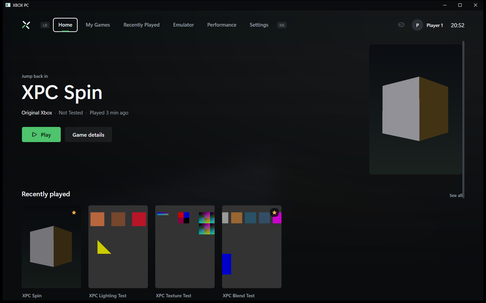
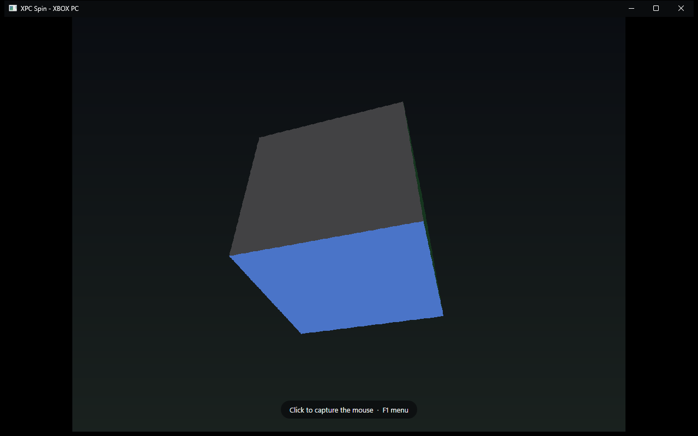
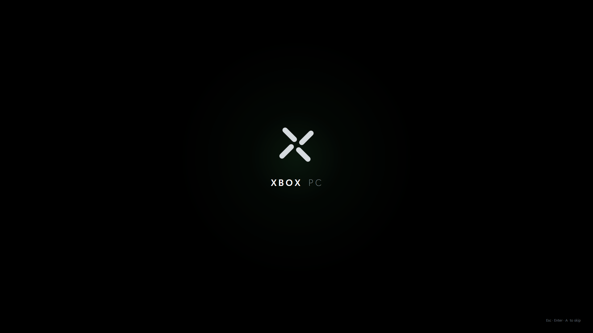
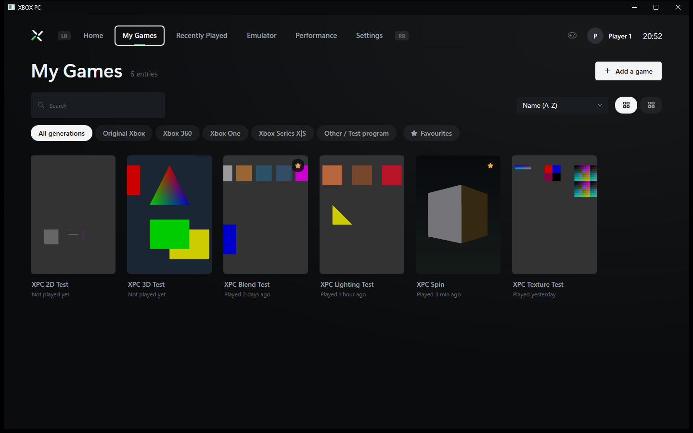
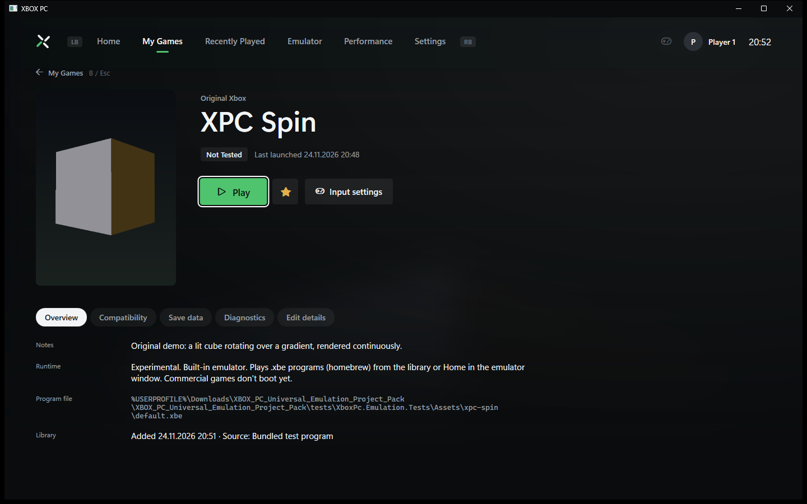
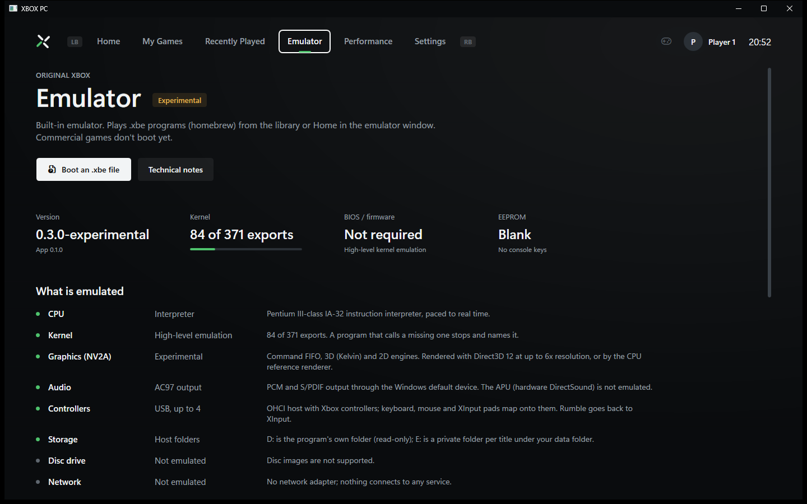
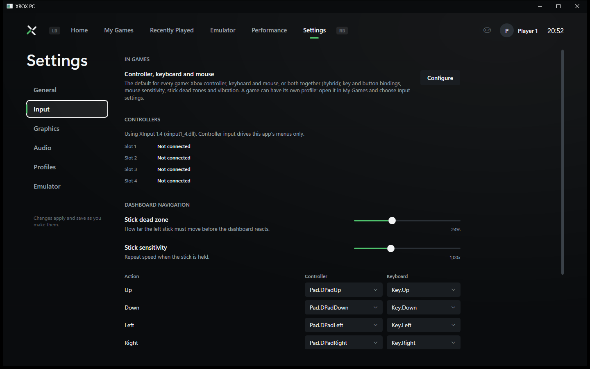
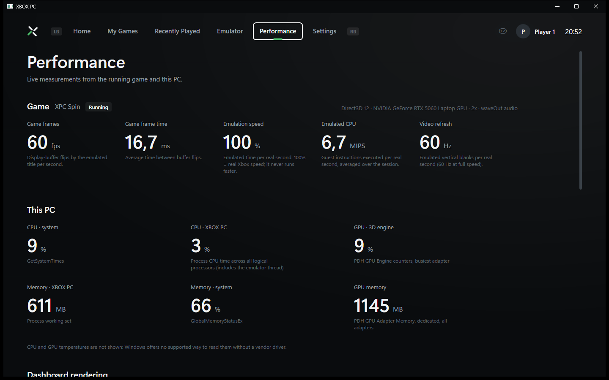
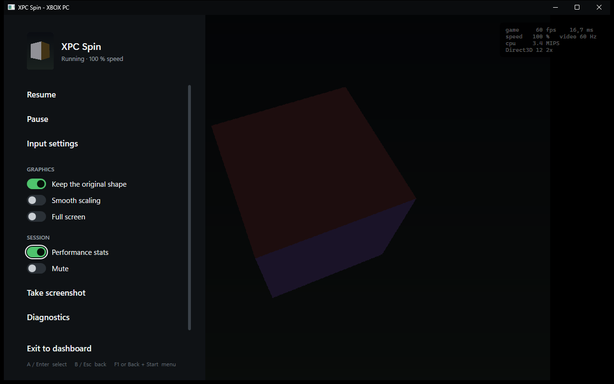
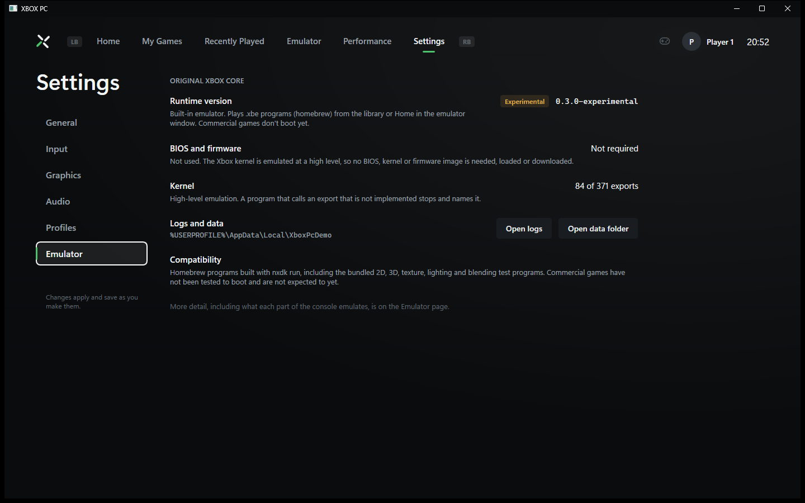

# XBOX PC

An experimental **Original Xbox emulator for Windows**, with a console-style game library and a Direct3D 12 renderer.
It is written from scratch in C# (.NET 9) and needs **no BIOS, firmware or files from Microsoft**: the Xbox kernel is
emulated at a high level.

> **Status: early and experimental.** Homebrew programs built with [nxdk](https://github.com/XboxDev/nxdk) run, at full
> speed and at up to 6x resolution. **Commercial games do not boot yet.** No compatibility is claimed for any game.

<p align="center">
  
  
</p>

## What works

| Part | State |
|---|---|
| **CPU** | IA-32 (Pentium III-class) interpreter with x87 and SSE, paced to real time |
| **Kernel** | High-level emulation: 84 of 371 exports (threads, memory, files, interrupts, video, USB). A program that calls a missing export stops and names it |
| **Graphics (NV2A)** | Command FIFO, Kelvin 3D (vertex programs, fixed-function lighting, register combiners, textures incl. DXT and swizzled, blending, stencil, logic ops), 2D blits, anti-aliased and swizzled render targets |
| **Direct3D 12 renderer** | Draws on the graphics card at 1x-6x resolution (6x = 3840x2880). Guest memory stays coherent: images are written back when the program reads them. A continuous demo runs at about 60 frames/s, against about 3 frames/s with the CPU renderer |
| **Audio** | AC97 PCM output (the APU / hardware DirectSound is not emulated) |
| **Input** | Up to 4 USB Xbox controllers from XInput pads, keyboard and mouse (with mouse capture), or both together; per-game profiles; rumble |
| **Storage** | D: is the program's folder (read-only); E: is a private folder per title |
| **App** | Start-up sequence with an original chime, console dashboard, library with covers, favourites and search, game pages, in-game menu (F1 or Back + Start), performance screen with live measurements, controller navigation everywhere |

Not yet: commercial games, disc images (ISO/XISO), the APU, a JIT for the CPU, network.

## Screenshots

| | |
|---|---|
|  Start-up |  My Games |
|  Game page |  Emulator: what is emulated |
|  Settings: input |  Performance: measured values only |
|  In-game menu with stats |  Settings: emulator |

The covers in the screenshots are frames the bundled test programs render themselves.

## Requirements

- Windows 10 or 11, 64-bit
- [.NET 9 SDK](https://dotnet.microsoft.com/download/dotnet/9.0)
- For the Direct3D 12 renderer: a graphics card with Direct3D 12 (feature level 11.0). Without one, the CPU renderer is used

## Build and run

```powershell
git clone <this repository's URL>
cd <the cloned folder>
dotnet build XboxPc.sln -c Release
dotnet run --project src/XboxPc.DesktopApp -c Release
```

Then add a program in **My Games**, or drop a `default.xbe` onto the Home screen. To try it straight away, run the bundled
demo:

```powershell
dotnet run --project src/XboxPc.DesktopApp -c Release -- --run "$PWD\tests\XboxPc.Emulation.Tests\Assets\xpc-spin\default.xbe"
```

Options: `--run <file.xbe>` starts a program, `--data-dir <folder>` uses a separate data folder, `--no-intro` skips the
start-up animation.

## Tests

```powershell
dotnet test tests/XboxPc.Tests                 # app: library, profiles, settings, UI smoke test
dotnet test tests/XboxPc.Emulation.Tests       # emulator: CPU, kernel, NV2A, audio, USB, test programs end to end
dotnet test tests/XboxPc.Emulation.Gpu.Tests   # Direct3D 12 against the CPU renderer (needs a GPU)
```

The emulator tests run original test programs (`homebrew/`, prebuilt in `tests/XboxPc.Emulation.Tests/Assets`) and compare
what they render and read back with values derived from their own definitions. The GPU tests check that the
Direct3D 12 renderer produces the same frames and the same read-back values as the CPU renderer.

## Building the test programs (optional)

The prebuilt programs are in the repository. To rebuild them you need [nxdk](https://github.com/XboxDev/nxdk) (on Windows,
in an MSYS2 MinGW64 shell); see [docs/engine/05_NXDK_TOOLCHAIN.md](docs/engine/05_NXDK_TOOLCHAIN.md) and
`homebrew/build-all.sh`.

## Project layout

| Folder | |
|---|---|
| `src/XboxPc.Emulation.*` | The emulator: CPU (`X86`), machine and kernel (`OriginalXbox`), GPU (`Gpu.Nv2a`, `Gpu.D3D12`), audio, USB, storage, input |
| `src/XboxPc.DesktopApp` | The WPF app |
| `src/XboxPc.Application`, `Domain`, `Infrastructure`, `Runtimes` | Library, profiles, settings, database, runtime contract |
| `tests/` | Tests and the prebuilt test programs |
| `homebrew/` | Sources of the original test programs |
| `docs/engine/` | Engineering notes and assessments, including what is and is not implemented |

## Legal

- No Microsoft BIOS, kernel, firmware, keys or game files are included, downloaded or required. The emulated EEPROM is
  blank.
- No copy protection, encryption or security mechanism is bypassed. Xbox 360, Xbox One and Xbox Series X|S software cannot
  run, and there is no plan to change that.
- Use only software you are legally entitled to run.
- "Xbox" is a trademark of Microsoft Corporation. This project is not affiliated with, endorsed by or sponsored by
  Microsoft. The app's logo, start-up sound and interface are original.

## License

[MIT](LICENSE)
